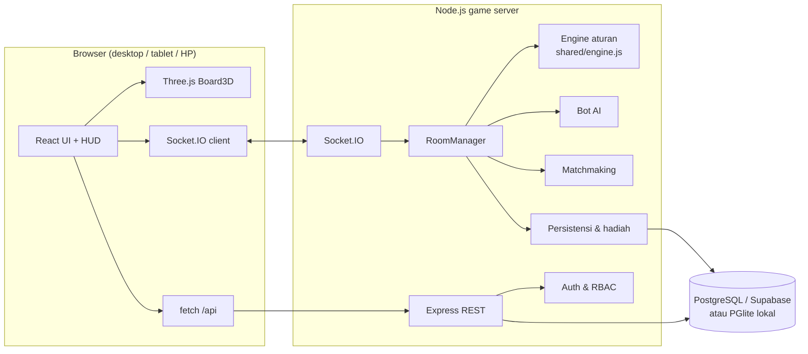
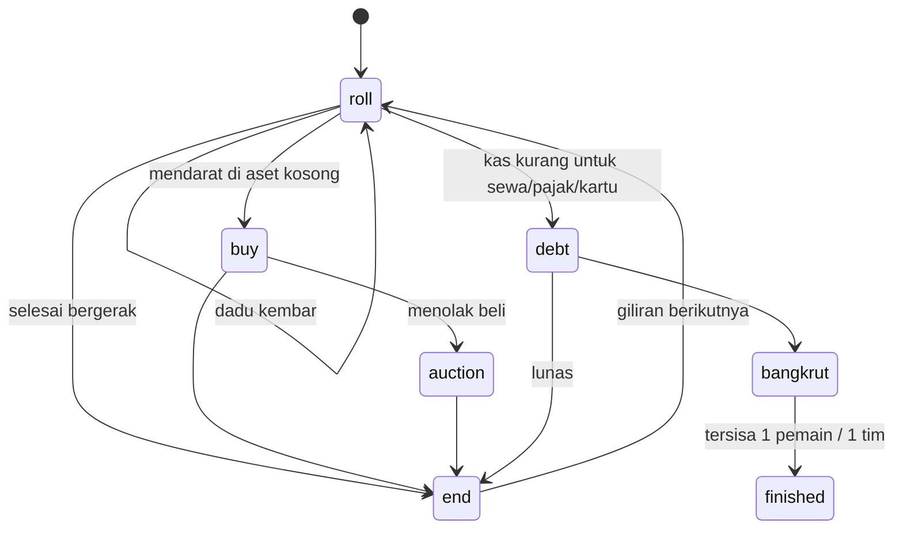

# Arsitektur Monopoli Indonesia

## Prinsip utama: server authoritative

1. Klien hanya mengirim **niat** (`{type:'roll'}`, `{type:'buy'}`, `{type:'build', tile:39}` …) lewat event `game:action`.
2. `RoomManager.handleAction` menyaring field (`sanitizeAction`), menolak aksi sistem (`time_up`, `auction_timeout`), memeriksa idempotensi `cid`, lalu memanggil `applyAction` di engine.
3. Engine (`shared/src/engine.js`) adalah fungsi murni atas state JSON: memeriksa giliran, fase, kepemilikan, saldo, aturan bangun merata, dll. Dadu memakai `crypto.randomInt` di server.
4. State hasil (tanpa urutan dek kartu — `publicState`) di-broadcast ke semua pemain di room. Klien merender & menganimasikan dari log event (`roll`, `move`, `buy`, `rent`, `card`, …).

Tidak ada saldo, posisi, hasil dadu, atau keputusan transaksi yang dipercaya dari klien. `localStorage` hanya menyimpan token sesi & preferensi tampilan.

## Alur giliran (fase engine)

## Timer & otomasi (RoomManager.schedule)

| Situasi | Perilaku |
|---|---|
| Pemain manusia tidak bertindak (timer giliran) | Server menjalankan aksi aman atas namanya (lempar dadu, **tolak** beli, mundur lelang, akhiri giliran). 3× timeout → mode otomatis sampai ia bertindak lagi. |
| Pemain terputus | Masa tenggang `DISCONNECT_GRACE_SEC` (60 dtk), lalu bot mengambil alih. Reconnect dengan token yang sama mengembalikan kendali. |
| Lelang | Ditutup otomatis 12 detik setelah tawaran terakhir. |
| Bot | Bertindak dengan jeda `BOT_DELAY_MS` agar animasi terlihat; juga merespons tawaran dagang. |
| Batas waktu permainan | Pemenang = total aset tertinggi. |
| Semua manusia keluar | Permainan diselesaikan (forfeit) agar sesi tidak menggantung. |

## Persistensi & pemulihan

- Setiap perubahan disimpan (debounce 400 ms) ke `game_events`, `dice_rolls`, `game_transactions`, `game_turns`, dan **snapshot state lengkap** di `game_sessions.state`.
- Saat server start, `RoomManager.restore()` memuat sesi berstatus `playing` dan melanjutkannya; pemain cukup membuka aplikasi lagi (socket otomatis kembali ke room).
- SIGTERM: server menyimpan state semua room aktif sebelum berhenti.
- Saat permainan selesai `finalizeMatch` (dalam satu transaksi DB): hasil per pemain, kepemilikan akhir (`player_properties`), statistik profil, koin/XP/Rank Point (tercatat di `wallet_transactions` dengan idempotency key), progres misi & achievement, leaderboard, poin guild, poin turnamen, bintang & hadiah Adventure. Permainan < 8 giliran tidak memberi hadiah (anti-farming).

## Keputusan teknis & alasannya

| Keputusan | Alasan | Konsekuensi |
|---|---|---|
| **Vite + React** (bukan Next.js) | Game adalah SPA real-time; SSR tidak memberi manfaat, sedangkan Vite menghasilkan bundle statis kecil (±260 KB gzip) yang bisa disajikan oleh server game sendiri atau di-host di Vercel. | Tidak ada SSR/SEO per halaman (tidak dibutuhkan untuk game). |
| **Three.js langsung** (bukan React Three Fiber / Phaser) | Kontrol penuh atas loop render, antrean animasi, dan optimasi (penggabungan geometri statis → ±130 draw call). Logika papan cukup di engine sendiri, Phaser tidak diperlukan. | Scene dikelola imperatif di `Board3D.ts`. |
| **CSS kustom** (bukan Tailwind) | Sistem desain game (tombol 3D, panel emas, pita) lebih ringkas sebagai satu stylesheet bertoken; satu dependensi build lebih sedikit. | — |
| **Auth sendiri + Supabase Auth opsional** | Server game harus bisa berjalan tanpa layanan eksternal (dan diuji di sini). Bila `SUPABASE_JWT_SECRET` diisi, login Google via Supabase aktif dan diverifikasi server. | Sesi server sendiri (token acak, hash SHA-256 di DB). |
| **pg + PGlite** | Satu skema SQL untuk Supabase/PostgreSQL produksi dan PGlite untuk pengembangan tanpa instalasi database. | PGlite satu koneksi — cocok untuk dev, bukan produksi. |
| **Aset prosedural** | Menjamin orisinalitas/lisensi dan ukuran unduhan sangat kecil. | Gaya visual low-poly bersih, bukan render pra-produksi. |
| **Satu proses server** | Sederhana & konsisten. | Skala horizontal memerlukan sticky session + adapter Redis Socket.IO dan pemindahan state room ke penyimpanan bersama (lihat Laporan Akhir). |
