# Dokumentasi Database

PostgreSQL 14+ (Supabase kompatibel). Skema: [`server/migrations/001_init.sql`](../server/migrations/001_init.sql). Data katalog di-seed otomatis dan idempoten oleh [`server/src/db/seed.js`](../server/src/db/seed.js). Migration dicatat di tabel `schema_migrations`.

## ERD

```mermaid
erDiagram
  users ||--|| player_profiles : memiliki
  users ||--|| player_wallets : memiliki
  users ||--o{ wallet_transactions : mencatat
  users ||--o{ sessions : login
  users ||--o{ player_inventory : memiliki
  users ||--o| admin_users : "role admin"
  users ||--o{ admin_audit_logs : melakukan
  users ||--o{ friendships : "berteman"
  users ||--o{ blocks : memblokir
  users ||--o{ player_reports : melapor
  users ||--o{ inbox_messages : menerima
  users ||--o{ chat_messages : mengirim
  guilds ||--o{ guild_members : beranggota
  users ||--o| guild_members : anggota
  characters ||--o{ character_skins : "skin outfit"
  property_groups ||--o{ properties : mengelompokkan
  card_decks ||--o{ game_cards : berisi
  game_rooms ||--o{ game_sessions : menjalankan
  game_sessions ||--o{ game_players : diikuti
  users ||--o{ game_players : bermain
  game_sessions ||--o{ game_turns : giliran
  game_sessions ||--o{ dice_rolls : dadu
  game_sessions ||--o{ game_transactions : transaksi
  game_sessions ||--o{ game_events : log
  game_sessions ||--o{ player_properties : "kepemilikan akhir"
  properties ||--o{ player_properties : aset
  live_events ||--o{ missions : "misi event"
  missions ||--o{ player_missions : progres
  achievements ||--o{ player_achievements : progres
  adventure_stages ||--o{ adventure_progress : progres
  tournaments ||--o{ tournament_entries : peserta
  users ||--o{ leaderboard_entries : peringkat
```

## Tabel

| Kelompok | Tabel | Isi penting |
|---|---|---|
| Akun | `users` | username unik (case-insensitive), email unik, `password_hash` (scrypt), provider (`local/guest/supabase`), `supabase_uid`, status blokir/bisu |
| | `sessions` | hash SHA-256 token, kedaluwarsa, dicabut, IP, user agent |
| Pemain | `player_profiles` | nama, gelar, level/XP, Rank Point, statistik, karakter/pion/dadu/emote terpilih, streak login harian |
| | `player_wallets` | koin, diamond, tiket — `CHECK (>= 0)` |
| | `wallet_transactions` | buku besar setiap perubahan koin/diamond/tiket/XP/RP, `balance_after`, `idempotency_key UNIQUE` |
| | `player_inventory` | item dimiliki, `UNIQUE(user_id,item_kind,item_id)` |
| Katalog | `characters`, `character_skins` | karakter adat & skin (pion, dadu, emote), cara perolehan, harga |
| Papan | `property_groups`, `properties`, `card_decks`, `game_cards` | 8 kelompok, 40 petak, 44 kartu (dapat diubah admin) |
| Permainan | `game_rooms` | kode, mode, privat, host, status, pengaturan |
| | `game_sessions` | status, **snapshot state** (pemulihan restart), pemenang, alasan selesai, durasi, ronde, turnamen/stage |
| | `game_players` | kursi, user/bot, tim, hasil akhir & hadiah |
| | `game_turns`, `dice_rolls`, `game_transactions`, `game_events` | jejak audit lengkap setiap pertandingan |
| | `player_properties` | kepemilikan akhir per sesi |
| Progres | `live_events`, `missions`, `player_missions`, `achievements`, `player_achievements`, `adventure_stages`, `adventure_progress` | misi harian/mingguan/event (`period_key`), achievement, bintang Adventure |
| Sosial | `friendships` (pasangan unik), `blocks`, `chat_messages` (flagged), `inbox_messages`, `player_reports`, `guilds`, `guild_members` (satu guild per pemain) | |
| Kompetisi | `tournaments`, `tournament_entries`, `leaderboard_entries` (`period`, `period_key`) | |
| Admin | `admin_users` (role), `admin_audit_logs`, `system_settings` (ekonomi, pemeliharaan, MOTD) | |

## Integritas & keamanan

- **Foreign key** di seluruh relasi (`ON DELETE CASCADE` untuk data milik pengguna).
- **Constraint**: format username, saldo tidak negatif, nilai dadu 1–6, level bangunan 0–5, role admin, status enum, `ends_at > starts_at`.
- **Index**: username/email (lower), sesi, transaksi per pengguna, leaderboard per periode, chat per kanal, room per status, event per sesi.
- **Transaction safety**: pembelian toko, klaim misi/inbox/harian, dan finalisasi pertandingan berjalan dalam transaksi. Debit memakai `UPDATE ... WHERE saldo + jumlah >= 0` (atomik, tanpa race). Pembelian ganda paralel dicegah oleh unique index inventaris.
- **Row Level Security** aktif di semua tabel. Server memakai koneksi langsung/service role (melewati RLS). Di Supabase, kebijakan baca-milik-sendiri dibuat untuk role `authenticated` (profil & dompet) serta baca publik katalog & leaderboard; tidak ada akses tulis dari klien.
- Kredensial tidak pernah dikirim ke frontend; `SUPABASE_JWT_SECRET` dan `DATABASE_URL` hanya ada di server.
